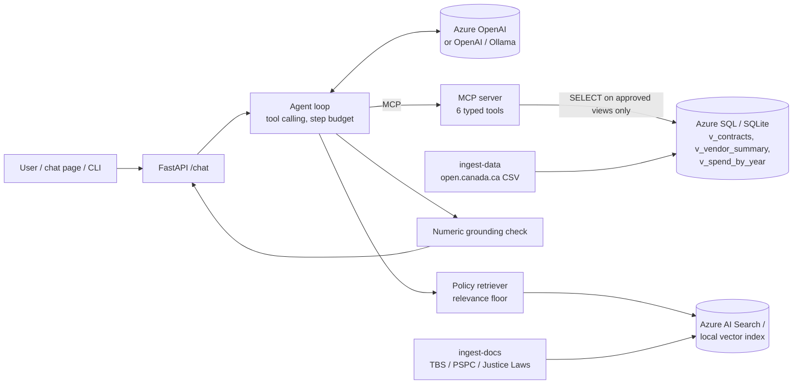

# Public Procurement Agent

An AI agent that answers questions about **Government of Canada contracts over $10,000** and the **procurement
policy** behind them. It uses governed, read-only data tools served over the **Model Context Protocol (MCP)**
and **retrieval-augmented generation (RAG)** over public Treasury Board and PSPC policy. Every answer shows
which tools ran, cites its sources, and is automatically checked so that no figure appears unless a tool
returned it.

Runs fully locally (OpenAI or Ollama, SQLite) or on **Azure** (Azure OpenAI, Azure AI Search, Azure SQL)
behind private endpoints with Entra ID auth and no keys.

> *"What share of contract value went non-competitive since 2023, and when does policy allow that?"*
>
> The agent calls `competition_summary` for the figures and `search_policy` for the rules, then answers with
> the shares, the filters it applied and section-level policy citations, flagged ✓ *all figures matched tool
> results*.

---

## What this project demonstrates

| Capability | Where |
|---|---|
| Agentic tool use with a bounded loop and full tool trace | [`agent/orchestrator.py`](src/procurement_agent/agent/orchestrator.py) |
| MCP server with typed, validated, read-only tools (no model-written SQL) | [`mcp_server/`](src/procurement_agent/mcp_server/) |
| Governed data access: approved views only, enforced in code **and** in the database | [`db/views.sql`](src/procurement_agent/db/views.sql), [`infra/sql/agent_reader.sql`](infra/sql/agent_reader.sql) |
| RAG: heading-aware parent/child chunking, relevance floor, section-level citations | [`rag/`](src/procurement_agent/rag/) |
| Hallucination guardrail: numeric grounding check on every answer | [`agent/guardrails.py`](src/procurement_agent/agent/guardrails.py) |
| Evaluation: golden question set with tool, grounding, citation and safety metrics | [`evals/`](evals/) |
| Azure IaC: VNet, private endpoints + private DNS, managed identity, least-privilege RBAC | [`infra/main.bicep`](infra/main.bicep) |
| CI/CD: lint, 45 offline tests, Bicep build, Docker build, on-demand evals via OIDC | [`.github/workflows/ci.yml`](.github/workflows/ci.yml) |
| Responsible AI: system card, risk assessment, ISO/IEC 42001-style control mapping | [`docs/governance/`](docs/governance/) |

## Architecture



The two data paths are separate on purpose. Ingest jobs write; the agent's identity can only read the three
approved views. See [design decisions](docs/design-decisions.md) for the reasoning behind each choice.

## Quickstart (local, about 5 minutes)

```bash
git clone https://github.com/BisolaAkinkuolie/Public-procurement-agent && cd Public-procurement-agent
python -m venv .venv && source .venv/bin/activate
pip install -e ".[dev]"
cp .env.example .env            # add an OpenAI key, or point at Ollama

procurement-agent ingest-data --sample   # synthetic demo data, instant
procurement-agent ingest-docs            # fetch public policy pages and build the index
procurement-agent serve-api              # open http://127.0.0.1:8000
```

Or from the terminal:

```bash
procurement-agent ask "Which vendors received the most services contract value since 2023?"
procurement-agent ask "When can a federal contract be awarded without competition?" --json
```

**Real data:** `procurement-agent ingest-data` (no `--sample`) downloads the full open dataset, several hundred
MB, and loads it in chunks.

**Use the tools from any MCP client** (Claude Desktop, VS Code, an Azure AI Foundry agent):

```bash
procurement-agent serve-mcp              # stdio
procurement-agent serve-mcp --http       # streamable HTTP on :8001/mcp
```

## The MCP tools

| Tool | Answers |
|---|---|
| `describe_data` | What period, how many vendors and departments, how value is defined |
| `top_vendors` | Who received the most, by value or count, filtered by keyword, department, type, years |
| `vendor_profile` | One vendor: totals, top departments, competitive mix, recent transactions |
| `spend_breakdown` | Spend by year, department, commodity type or solicitation procedure |
| `competition_summary` | Competitive vs non-competitive vs ACAN shares; average bids |
| `search_contracts` | Individual contracts matching a description keyword |

Every result carries `source`, `view` and `filters`, so the agent can say exactly what a figure covers.

## Getting the numbers right

The published data needs care before it can be summed:

- **Amendments** are separate rows carrying the new *total* value. Summing `contract_value` double counts them.
  This project uses `committed_value`: original value for new contracts, amendment value for amendment rows.
- **Standing offer agreements** (`SOSA`) are agreements, not spend, so they are excluded.
- **Vendor names** vary ("ACME CONSULTING INC." vs "Acme Consulting Inc"), so they are normalised to a
  `vendor_key`.

## Evaluation

```bash
python evals/run_evals.py     # uses your configured model; writes evals/results/<timestamp>.md
```

Eleven golden questions cover rankings, profiles, trends, competition, policy-only, mixed data + policy,
an out-of-scope question and an attempt to elicit an accusation. Metrics: tool selection, numeric grounding,
policy citation, safety and latency. In CI the eval job runs on demand against Azure OpenAI using OIDC
federation (no stored secrets).

## Deploying to Azure

```bash
az group create -n rg-procurement-agent -l canadacentral
az deployment group create -g rg-procurement-agent -f infra/main.bicep -p infra/main.parameters.json
```

This deploys a VNet with an app subnet and a private-endpoint subnet; Azure OpenAI, AI Search and Azure SQL,
all with public access disabled and key auth off; private DNS zones; an App Service container with VNet
integration and a managed identity holding only *Cognitive Services OpenAI User* and *Search Index Data
Reader*; and Application Insights. Then, as the SQL admin, load the data and run
[`infra/sql/agent_reader.sql`](infra/sql/agent_reader.sql) to grant the app SELECT on the approved views only.

## Repository layout

```
src/procurement_agent/
  agent/         orchestrator, toolbox (MCP + RAG bridge), guardrails, prompt
  mcp_server/    MCP server and parameterised queries over approved views
  rag/           sources, HTML→markdown, chunking, vector stores, retriever
  db/            ingest pipeline, approved views, read-only engine
  api/           FastAPI app and chat page
infra/           Bicep and SQL grants
evals/           golden set and eval runner
docs/            design decisions, governance
tests/           45 offline tests (no network, no model needed)
```

## Limitations

- Figures reflect what departments published, include taxes, and are not invoiced or paid amounts.
- Vendor normalisation can merge distinct companies whose names differ only by legal suffix.
- The policy index is only as current as the last `ingest-docs` run.
- `data/sample/` is **synthetic** and exists for tests and demos only.

## Data and licences

Contract data: *Proactive Publication – Contracts*, Treasury Board of Canada Secretariat, via the Open
Government Portal, under the Open Government Licence – Canada. Policy documents are fetched from their
official sources at setup time and are not redistributed in this repository. Code: MIT.

Built by **Bisola Akinkuolie**, AI Engineer.
